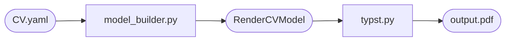

# Rule: Vẽ sơ đồ Mermaid

## Nguyên tắc bắt buộc

### Giữ text trong node thật ngắn gọn

Mỗi node/khối trong sơ đồ Mermaid **chỉ nên chứa tên định danh**, không nhét mô tả chi tiết vào bên trong. Mô tả đi vào phần văn bản **bên ngoài** sơ đồ.

**❌ Sai — quá nhiều chữ trong node:**
```
A["rendercv_model_builder.py\nbuild_rendercv_dictionary_and_model()\nYAML → merge overlays → apply overrides\nPydantic validation → RenderCVModel"]
```

**✅ Đúng — node ngắn, mô tả ở ngoài:**
```
A["rendercv_model_builder.py"]
```
> Mô tả: `build_rendercv_dictionary_and_model()` merge YAML overlays, apply overrides, validate với Pydantic.

---

## Quy tắc cụ thể

| Loại nội dung | Trong node | Ngoài node |
|---|---|---|
| Tên file / module | ✅ | — |
| Tên hàm chính | ✅ (1 hàm max) | — |
| Mô tả chức năng | ❌ | ✅ |
| Ví dụ / giải thích | ❌ | ✅ |
| Ghi chú kỹ thuật | ❌ | ✅ |

## Quy tắc về độ dài nhãn node

- **Tối đa 2 dòng** trong một node
- **Mỗi dòng tối đa ~30 ký tự**
- Dùng ký hiệu emoji (📄 📐 🎨) để nhận diện nhanh thay cho chữ dài
- Subgraph title có thể dài hơn vì là tiêu đề nhóm, không phải node

## Cách bố cục mô tả

Sau mỗi sơ đồ, dùng một trong các hình thức:

1. **Bảng** — tóm tắt từng node theo cột (Node | Vai trò)
2. **Danh sách có đánh số** — giải thích từng bước theo thứ tự
3. **Code block có cite** — trích dẫn code liên quan

---

## Ví dụ đúng



**Giải thích:**
- `model_builder.py`: parse YAML, merge overlays, validate Pydantic → `RenderCVModel`
- `typst.py`: render Jinja2 templates → `.typ`, compile qua Typst compiler → `.pdf`
