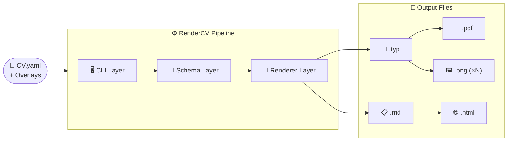
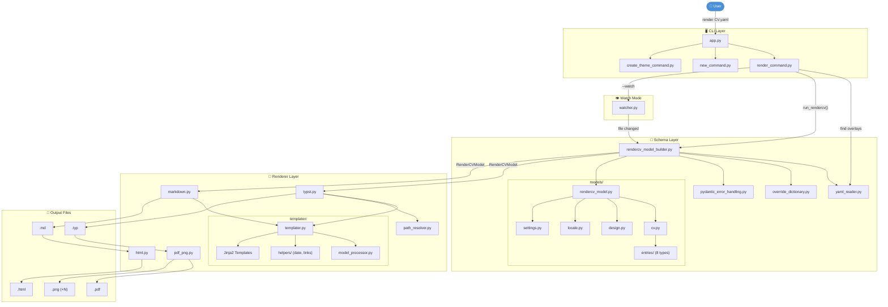
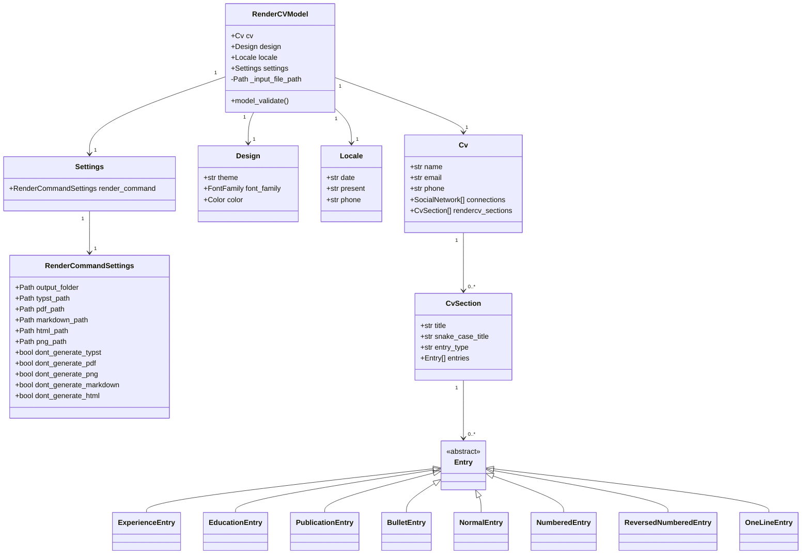
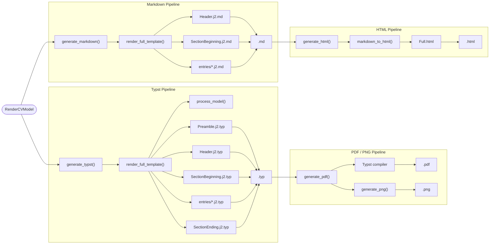
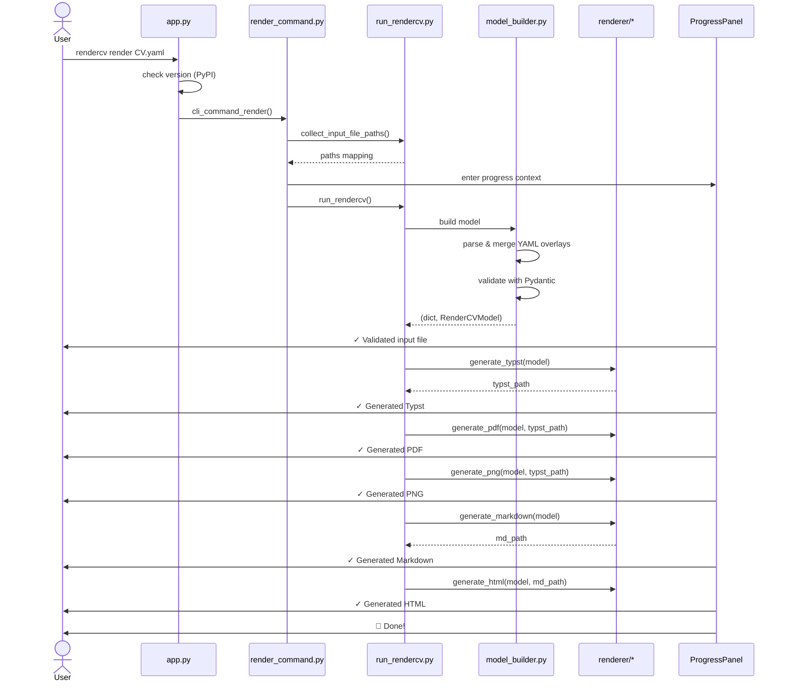

# Kiến Trúc RenderCV

Tài liệu này mô tả kiến trúc tổng thể và luồng xử lý của source code RenderCV.
Mỗi sơ đồ đi kèm giải thích chi tiết với dẫn chiếu trực tiếp tới code.

---

## 0. Overview — Luồng tổng quát

Sơ đồ tổng quát thể hiện toàn bộ hành trình từ file YAML đầu vào đến các file output.



| Layer | Thư mục | Trách nhiệm |
|---|---|---|
| **CLI** | `src/rendercv/cli/` | Nhận args từ user, gọi pipeline, hiển thị progress |
| **Schema** | `src/rendercv/schema/` | Parse & validate YAML, build `RenderCVModel` |
| **Renderer** | `src/rendercv/renderer/` | Render templates (Jinja2), compile PDF/PNG (Typst) |

> **Dependency chain của outputs:**
> - `Typst (.typ)` là bắt buộc để sinh `PDF` và `PNG`
> - `Markdown (.md)` là bắt buộc để sinh `HTML`
> - Nếu tắt Typst generation (`--dont-generate-typst`), PDF và PNG cũng tự động bị tắt

---

## 1. Tổng quan luồng xử lý (High-level Flow)




### Mô tả chi tiết

#### Bước 1 — Khởi động CLI

Entry point là `src/rendercv/cli/app.py`. Typer app được khai báo với `invoke_without_command=True` để lệnh `rendercv --version` hoạt động mà không cần sub-command:

```python
# cli/app.py:19-24
app = typer.Typer(
    rich_markup_mode="rich",
    invoke_without_command=True,
    context_settings={"help_option_names": ["-h", "--help"]},
)
```

Các sub-command (`render`, `new`, `create-theme`) được **tự động import** bằng cách scan thư mục tìm file `*_command.py`:

```python
# cli/app.py:140-149
cli_folder_path = pathlib.Path(__file__).parent
for file in cli_folder_path.rglob("*_command.py"):
    folder_name = file.parent.name   # e.g. "render_command"
    py_file_name = file.stem         # e.g. "render_command"
    full_module = f"{__package__}.{folder_name}.{py_file_name}"
    module = importlib.import_module(full_module)
```

Mỗi lần chạy CLI, `warn_if_new_version_is_available()` kiểm tra phiên bản mới từ PyPI bằng cache disk (TTL 24 giờ) thông qua background thread để không block CLI.

#### Bước 2 — Thu thập input files

`run_rendercv.py::collect_input_file_paths()` thu thập tất cả file YAML liên quan (main, design, locale, settings). Nếu user truyền `--design` hoặc `--locale` qua CLI, chúng được dùng trực tiếp; nếu không, hàm parse YAML chính để tìm đường dẫn trong `settings.render_command`:

```python
# cli/render_command/run_rendercv.py:113-122
with contextlib.suppress(RenderCVUserValidationError):
    main_dict = read_yaml_with_validation_errors(...)
    rc = main_dict.get("settings", {}).get("render_command", {})
    if "design" not in files and rc.get("design"):
        files["design"] = (input_file_path.parent / rc["design"]).resolve()
```

Danh sách đầy đủ này được Watch Mode dùng để theo dõi mọi file liên quan.

#### Bước 3 — Pipeline render

`run_rendercv()` điều phối toàn bộ pipeline theo thứ tự cố định. Mỗi bước được bọc trong `timed_step()` để hiển thị thời gian thực thi lên `ProgressPanel`:

```python
# cli/render_command/run_rendercv.py:142-182
_, rendercv_model = timed_step("Validated the input file", ...)
typst_path = timed_step("Generated Typst", progress, generate_typst, rendercv_model)
timed_step("Generated PDF",  progress, generate_pdf,      rendercv_model, typst_path)
timed_step("Generated PNG",  progress, generate_png,      rendercv_model, typst_path)
md_path    = timed_step("Generated Markdown", progress, generate_markdown, rendercv_model)
timed_step("Generated HTML", progress, generate_html,     rendercv_model, md_path)
```

> **Dependency quan trọng:** PDF và PNG phụ thuộc vào `typst_path` (output của bước Typst). HTML phụ thuộc vào `md_path` (output của bước Markdown). Nếu một bước bị tắt (`dont_generate_typst=True`), bước con của nó cũng tự động bị bỏ qua.

#### Bước 4 — Xử lý lỗi

Ba loại lỗi được xử lý riêng biệt trong `exception.py`:

| Exception | Ý nghĩa | Xử lý |
|---|---|---|
| `RenderCVUserValidationError` | Lỗi schema YAML (nhiều lỗi cùng lúc) | In tất cả lỗi với vị trí line/column |
| `RenderCVUserError` | Lỗi người dùng (file không tồn tại, ảnh không tải được) | In thông báo sạch, không có stack trace |
| `RenderCVInternalError` | Bug nội bộ của RenderCV | Không nên xảy ra với user bình thường |

---

## 2. Chi tiết Schema Layer



### Mô tả chi tiết

#### RenderCVModel — Root model

`RenderCVModel` (`schema/models/rendercv_model.py`) là Pydantic model gốc, gom 4 section:

```python
# schema/models/rendercv_model.py:14-51
class RenderCVModel(BaseModelWithoutExtraKeys):
    cv:       Cv       = pydantic.Field(default_factory=Cv)
    design:   Design   = pydantic.Field(default_factory=ClassicTheme)
    locale:   Locale   = pydantic.Field(default_factory=EnglishLocale)
    settings: Settings = pydantic.Field(default_factory=Settings)
    _input_file_path: pathlib.Path | None = pydantic.PrivateAttr(default=None)
```

`_input_file_path` là private attribute, được set sau khi validate xong qua `model_validator(mode="after")`. Nó được dùng downstream để resolve đường dẫn ảnh và template.

#### Tự động nhận dạng Entry Type

User không cần khai báo loại entry — `section.py` tự detect dựa trên các field **đặc trưng** của từng loại:

```python
# schema/models/cv/section.py:24-34
type EntryModel = (
    OneLineEntry | NormalEntry | ExperienceEntry | EducationEntry
    | PublicationEntry | BulletEntry | NumberedEntry | ReversedNumberedEntry
)
type Entry = EntryModel | str  # str = TextEntry (plain text)
```

`get_characteristic_entry_fields()` tính toán field nào là unique cho từng type (ví dụ `degree` → `EducationEntry`, `journal` → `PublicationEntry`) để routing tự động khi validate.

#### Overlay & Override System

`rendercv_model_builder.py::build_rendercv_dictionary()` merge nhiều nguồn YAML theo thứ tự ưu tiên:

```
Main YAML  <  Overlay files (design/locale/settings)  <  CLI --field overrides
```

```python
# schema/rendercv_model_builder.py:117-155
input_dict = read_yaml_with_validation_errors(main_yaml_file, "main_yaml_file")
# Overlay files ghi đè từng section:
for key, yaml_content in yaml_overlays.items():
    if yaml_content:
        input_dict[key] = overlay_cm[key]
# CLI flags ghi đè settings.render_command:
for key, value in render_overrides.items():
    if value:
        input_dict["settings"]["render_command"][key] = value
# --YAMLLOCATION overrides ghi đè bất kỳ field nào:
input_dict = apply_overrides_to_dictionary(input_dict, overrides)
```

#### Error Reporting với YAML line/column

Pydantic validation errors thiếu thông tin vị trí file YAML. `pydantic_error_handling.py::parse_validation_errors()` map lại từng `pydantic.ValidationError` về `RenderCVValidationError` chứa `yaml_location: tuple[tuple[int,int], tuple[int,int]]` (start/end line+column), giúp CLI hiển thị đúng dòng lỗi.

---

## 3. Chi tiết Renderer Layer



### Mô tả chi tiết

#### Typst Pipeline — Intermediate format

Typst là định dạng trung gian trước khi compile ra PDF/PNG. `generate_typst()` trong `renderer/typst.py` gọi `render_full_template(rendercv_model, "typst")` để sinh file `.typ`:

```python
# renderer/typst.py:23-30
def generate_typst(rendercv_model: RenderCVModel) -> pathlib.Path | None:
    if rendercv_model.settings.render_command.dont_generate_typst:
        return None
    typst_path = resolve_rendercv_file_path(...)
    typst_contents = render_full_template(rendercv_model, "typst")
    typst_path.write_text(typst_contents, encoding="utf-8")
    return typst_path
```

`render_full_template()` trong `templater/templater.py` lắp ghép document theo thứ tự: **Preamble → Header → (SectionBeginning + Entries + SectionEnding) × N sections**:

```python
# renderer/templater/templater.py:82-128
download_photo_from_url(rendercv_model)      # download nếu photo là URL
rendercv_model = process_model(rendercv_model, file_type)

preamble = render_single_template("typst", "Preamble.j2.typ", ...)
header   = render_single_template("typst", "Header.j2.typ", ...)
code = f"{preamble}\n\n{header}\n"

for rendercv_section in rendercv_model.cv.rendercv_sections:
    # Mỗi section render 3 phần: beginning + entries + ending
    entry_code = render_single_template(
        "typst", f"entries/{rendercv_section.entry_type}.j2.typ", ...
    )
```

**User template override:** `render_single_template()` kiểm tra thư mục input file trước, fallback về built-in templates nếu không tìm thấy:

```python
# renderer/templater/templater.py:197-207
# Thử template của user (e.g. classic/Header.j2.typ) trước:
with contextlib.suppress(jinja2.TemplateNotFound):
    template = env.get_template(f"{design.theme}/{relative_template_path}")
# Fallback về built-in:
if template is None:
    template = env.get_template(f"{file_type}/{relative_template_path}")
```

#### PDF/PNG Pipeline — Typst compiler

`generate_pdf()` và `generate_png()` dùng `typst-py` (Python binding của Typst compiler). Compiler được cache bằng `@functools.lru_cache` để không khởi tạo lại nhiều lần:

```python
# renderer/pdf_png.py:205-237
@functools.lru_cache(maxsize=1)
def get_typst_compiler(input_file_path, root) -> typst.Compiler:
    return typst.Compiler(
        root=root,
        font_paths=[*rendercv_fonts.paths_to_font_folders, input_file_path.parent / "fonts"],
        package_path=get_package_path(),  # temp dir với bundled packages
    )
```

Typst packages (`rendercv` và `fontawesome`) được ship kèm Python package và copy vào temp directory theo cấu trúc `preview/{name}/{version}/` mà Typst compiler yêu cầu — không cần kết nối internet.

PNG output là multi-page: mỗi trang CV tạo ra một file `Name_CV_1.png`, `Name_CV_2.png`, ...

#### Markdown Pipeline

`generate_markdown()` hoạt động tương tự Typst nhưng không có Preamble:

```python
# renderer/markdown.py:27-28
markdown_contents = render_full_template(rendercv_model, "markdown")
markdown_path.write_text(markdown_contents, encoding="utf-8")
```

#### HTML Pipeline — phụ thuộc Markdown

HTML không render trực tiếp từ model mà **đọc lại file Markdown đã sinh**:

```python
# renderer/html.py:33-34
html_contents = render_html(
    rendercv_model, markdown_path.read_text(encoding="utf-8")
)
```

`render_html()` convert Markdown → HTML body (qua `markdown_to_html()`), rồi nhúng vào `Full.html` Jinja2 template chứa `<head>`, CSS và metadata.

---

## 4. CLI Command Flow



### Mô tả chi tiết

#### Luồng dữ liệu qua các participant

1. **User → App**: Gọi `rendercv render CV.yaml [flags]`. `app.py` kiểm tra version update qua background daemon thread (không block).

2. **App → render_command.py**: `cli_command_render()` được decorated bởi `@handle_user_errors` — mọi `RenderCVUserError` và `RenderCVUserValidationError` raise bên trong sẽ bị catch và in ra panel đẹp thay vì traceback.

3. **render_command.py → run_rendercv.py**: `collect_input_file_paths()` trả về dict mapping role → path. Nếu user dùng `--watch`, hàm này được gọi lại mỗi lần file thay đổi.

4. **run_rendercv.py → rendercv_model_builder.py**: `build_rendercv_dictionary_and_model()` thực hiện 3 việc:
   - Parse YAML với `ruamel.yaml` (giữ nguyên line/column metadata trong `CommentedMap`)
   - Merge overlays và apply CLI overrides
   - Validate qua `RenderCVModel.model_validate()` với Pydantic

5. **Renderer steps**: Mỗi bước nhận `RenderCVModel` (immutable sau validation) và trả về `pathlib.Path` của file đã tạo. `typst_path` và `md_path` là dependency trực tiếp cho các bước tiếp theo.

6. **ProgressPanel**: Wrapper Rich panel hiển thị checkmark + thời gian cho mỗi bước. `timed_step()` đo thời gian bằng `time.perf_counter()` và call `progress_panel.update_progress()`.

#### Watch Mode

Khi `--watch` được truyền, `watcher.py::run_function_if_files_change()` dùng polling để detect thay đổi trên **tất cả** file trong `resolved_files` (main YAML + design + locale + settings overlay). Mỗi khi có thay đổi, toàn bộ pipeline `run_rendercv()` được chạy lại từ đầu.

---

## 5. Cấu trúc thư mục

```
rendercv/
├── src/
│   └── rendercv/
│       ├── __init__.py
│       ├── __main__.py
│       ├── exception.py
│       │
│       ├── cli/                                   # CLI Layer
│       │   ├── app.py                             # Typer app, version check
│       │   ├── entry_point.py
│       │   ├── error_handler.py
│       │   ├── copy_templates.py
│       │   ├── render_command/
│       │   │   ├── render_command.py              # `rendercv render` command
│       │   │   ├── run_rendercv.py                # Pipeline orchestrator
│       │   │   ├── progress_panel.py              # Rich progress display
│       │   │   ├── watcher.py                     # File watch mode
│       │   │   └── parse_override_arguments.py
│       │   ├── new_command/
│       │   │   ├── new_command.py                 # `rendercv new` command
│       │   │   └── print_welcome.py
│       │   └── create_theme_command/
│       │       └── create_theme_command.py
│       │
│       ├── schema/                                # Schema & Validation Layer
│       │   ├── yaml_reader.py                     # YAML parser (ruamel)
│       │   ├── rendercv_model_builder.py          # YAML → RenderCVModel
│       │   ├── override_dictionary.py             # CLI override merging
│       │   ├── pydantic_error_handling.py         # Error formatting
│       │   ├── variant_pydantic_model_generator.py
│       │   ├── sample_generator.py
│       │   ├── json_schema_generator.py
│       │   ├── error_dictionary.yaml
│       │   ├── sample_content.yaml
│       │   └── models/
│       │       ├── rendercv_model.py              # Root model (cv + design + locale + settings)
│       │       ├── base.py
│       │       ├── validation_context.py
│       │       ├── cv/
│       │       │   ├── cv.py                      # Cv model
│       │       │   ├── section.py                 # CvSection model
│       │       │   ├── social_network.py
│       │       │   ├── custom_connection.py
│       │       │   └── entries/                   # 8 entry types
│       │       │       ├── experience.py
│       │       │       ├── education.py
│       │       │       ├── publication.py
│       │       │       ├── bullet.py
│       │       │       ├── normal.py
│       │       │       ├── numbered.py
│       │       │       ├── reversed_numbered.py
│       │       │       └── one_line.py
│       │       ├── design/
│       │       │   ├── design.py                  # Design union type
│       │       │   ├── classic_theme.py           # ClassicTheme (default)
│       │       │   ├── built_in_design.py
│       │       │   ├── color.py
│       │       │   ├── font_family.py
│       │       │   ├── typst_dimension.py
│       │       │   └── other_themes/
│       │       ├── locale/
│       │       │   └── locale.py                  # Locale / EnglishLocale
│       │       └── settings/
│       │           └── settings.py                # Settings + RenderCommandSettings
│       │
│       └── renderer/                              # Renderer Layer
│           ├── typst.py                           # generate_typst()
│           ├── pdf_png.py                         # generate_pdf() / generate_png()
│           ├── markdown.py                        # generate_markdown()
│           ├── html.py                            # generate_html()
│           ├── path_resolver.py                   # Output path resolution
│           ├── rendercv_typst/                    # Bundled Typst binary
│           ├── typst_fontawesome/                 # Font assets
│           └── templater/
│               ├── templater.py                   # render_full_template()
│               ├── model_processor.py             # process_model()
│               ├── markdown_parser.py             # markdown_to_html()
│               ├── date.py                        # Date formatting helpers
│               ├── connections.py                 # Social link helpers
│               ├── string_processor.py            # String utilities
│               ├── footer_and_top_note.py
│               ├── entry_templates_from_input.py
│               └── templates/                     # Jinja2 templates
│                   ├── typst/
│                   │   ├── Preamble.j2.typ
│                   │   ├── Header.j2.typ
│                   │   ├── SectionBeginning.j2.typ
│                   │   ├── SectionEnding.j2.typ
│                   │   └── entries/
│                   ├── markdown/
│                   │   ├── Header.j2.md
│                   │   ├── SectionBeginning.j2.md
│                   │   └── entries/
│                   └── html/
│                       └── Full.html
│
└── scripts/
    ├── create_executable.py
    ├── update_schema.py
    ├── update_examples.py
    ├── update_entry_figures.py
    └── rendercv_skill/
        ├── generate.py
        ├── skill_template.j2.md
        └── evals/
```
